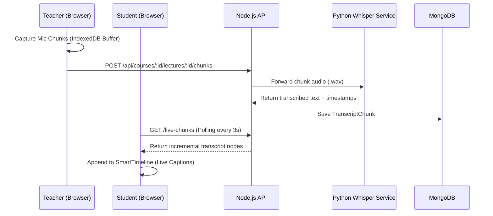
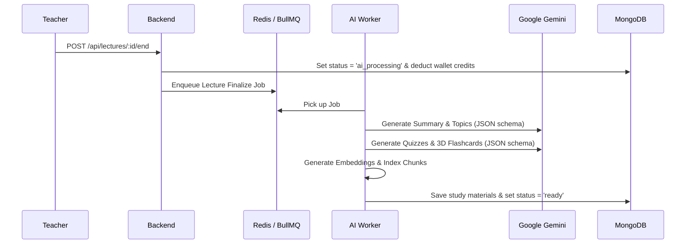

# AI Classroom Platform

A real-time, offline-resilient, transcript-driven educational platform that transforms live spoken lectures into an interactive, AI-powered study workspace. 

Powered by **OpenAI Whisper**, **Google Gemini 1.5 Flash**, **BullMQ + Redis**, and **Razorpay**, the platform captures the instructor's microphone audio, streams live captions to students in real time, and automatically generates structured notes, 3D flashcards, quizzes, and a cited AI Q&A tutor the moment class ends.

---

## 🌟 Key Features

### 🎙️ 1. Live & Offline-First Audio Streaming
- **Microphone-Only Capture:** No heavy video streams required. Instructors stream audio chunks directly from their browser microphone.
- **IndexedDB Offline Buffer:** Voice chunks are cached in the browser's local database before uploading. If campus Wi-Fi drops mid-lecture, recording continues uninterrupted and auto-syncs when reconnected — **zero data loss**.
- **Real-Time Student Captions:** Students join live classes (`/courses/:courseId/live`) and watch the instructor's speech transcribe into text on their screen within 3 seconds.

### ⏱️ 2. Smart Virtuoso Transcript Timeline
- **60 FPS DOM Virtualization:** Built with **React Virtuoso** to smoothly render thousands of transcript chunks for 2+ hour lectures without browser lag or memory bloat.
- **Bi-directional Media/Time Sync:** Click any sentence in the transcript to jump directly to that exact second.

### 🧠 3. Post-Lecture AI Study Workspace
Once the instructor ends the lecture, an async background pipeline generates:
- **Executive Summaries & Chapters:** High-level takeaways, key bullet points, and semantic timeline topics.
- **Interactive 3D Flashcards:** Flippable flashcards with keyboard navigation (`Space` / `Arrow keys`) for active recall studying.
- **Auto-Generated Quizzes (MCQs):** Multiple-choice questions with instant evaluation, scoring, and AI explanations.

### 🔍 4. In-Lecture AI Tutor (Grounded RAG)
- **Local Vector Search:** Generates mathematical vector embeddings for every lecture segment and performs cosine similarity search.
- **Anti-Hallucination Citations:** Answers student questions with **clickable timestamp citations (e.g., `Jump to [14:22]`)**, referencing the exact sentence in the lecture transcript.

### 💳 5. AI Credit Wallet & Razorpay Billing
- **Usage Metering:** AI operations are metered against a digital credit wallet (e.g., 1 credit per minute of lecture processed).
- **Razorpay Checkout:** Instructors and institutions can top up credits via secure Razorpay checkout (INR).
- **Cryptographic Security:** Backend verifies `razorpay_signature` using **HMAC SHA-256** with audit logs (`CreditTransaction`) to prevent spoofing and double-spending.

### 👥 6. Course & Organization Management
- **Role-Based Access Control (RBAC):** Distinct workflows for Teachers (recording studio, live session management, course creation) and Students (live caption viewer, study workspace).
- **Session Recovery:** Teachers can safely end orphaned or active live sessions directly from the course dashboard or live viewer with automatic duration safety caps.

---

## 🏗 System Architecture & Tech Stack

```
[Teacher Microphone] ──► [IndexedDB Buffer] ──► [Express Backend API]
                                                      │
                       ┌──────────────────────────────┴──────────────────────────────┐
                       ▼                                                             ▼
           [Python Whisper Service]                                       [BullMQ + Redis Worker]
            (FastAPI Audio -> Text)                                                  │
                       │                                                             ▼
                       ▼                                                 [Google Gemini 1.5 Flash]
              [MongoDB Database] ◄───────────────────────────────────── (Summaries, Quizzes, Flashcards,
         (Chunks, Lectures, Wallets)                                        Vector Cosine Embeddings)
                       │
                       ▼
         [Frontend: React Virtuoso] ──► [Live Captions / AI Study Workspace]
```

### Tech Stack Details
- **Frontend:** React 18, TypeScript, Vite, Zustand, Tailwind CSS, React Virtuoso, Lucide Icons
- **Backend:** Node.js, Express, TypeScript, MongoDB (Mongoose), BullMQ, Zod
- **Queue & Cache:** Redis
- **Speech-to-Text:** Python, FastAPI, OpenAI Whisper, Uvicorn
- **AI / LLM:** Google Gemini 1.5 Flash, Local Vector Cosine Similarity Search
- **Payments:** Razorpay SDK (Orders API + HMAC SHA-256 Signature Verification)

---

## 📸 Core Workflow Diagrams

### 1. Recording & Live Student Streaming


### 2. Async AI Finalization Pipeline


---

## 🚀 Getting Started

### Prerequisites
- **Node.js:** v18+
- **MongoDB:** Running locally (`mongodb://localhost:27017`)
- **Redis:** Running locally (`127.0.0.1:6379`)
- **Python:** 3.10+ (for Whisper service)
- **Google Gemini API Key**
- **Razorpay Key & Secret** (Test mode keys for billing)

---

### Installation

1. **Clone the repository:**
   ```bash
   git clone https://github.com/rohitrathod-4004/AI-Classroom.git
   cd AI-Classroom
   ```

2. **Install root & workspace dependencies:**
   ```bash
   npm install
   ```

3. **Configure Environment Variables:**
   Create `.env` inside `apps/backend/.env`:
   ```env
   PORT=4000
   NODE_ENV=development
   MONGO_URI=mongodb://localhost:27017/lecture-transcription
   REDIS_HOST=127.0.0.1
   REDIS_PORT=6379
   JWT_SECRET=your_jwt_secret_key_here
   GEMINI_API_KEY=your_gemini_api_key_here
   WHISPER_SERVICE_URL=http://localhost:8000
   RAZORPAY_KEY_ID=your_razorpay_key_id
   RAZORPAY_KEY_SECRET=your_razorpay_key_secret
   ```

4. **Set Up Python Whisper Service:**
   ```bash
   cd python-services/whisper-service
   python -m venv venv
   # Windows:
   .\venv\Scripts\activate
   # Linux/macOS:
   source venv/bin/activate

   pip install -r requirements.txt
   ```

---

### Running Locally

Open three terminal windows:

#### Terminal 1: Python Whisper Service
```bash
cd python-services/whisper-service
uvicorn main:app --reload --port 8000
```

#### Terminal 2: Backend API & AI Workers
```bash
cd apps/backend
npm run dev
```

#### Terminal 3: Frontend Client
```bash
cd apps/frontend
npm run dev
```
Visit **`http://localhost:5173`** in your browser.

---

## 🧪 Demo & Showcase Flow

1. **Log in:** Log in as a Teacher or Student.
2. **Start a Live Lecture (Teacher):**
   - Navigate to a Course and click **"Start New Lecture"**.
   - Select your microphone and begin speaking.
3. **View Live Captions (Student):**
   - Open an incognito window, log in as a Student, and navigate to `/courses/:courseId/live`.
   - Watch speech appear live on the timeline as the instructor speaks.
4. **End Session:**
   - Click **"End Live Session"** from either the recording screen, live viewer, or course banner.
5. **Explore the AI Study Workspace:**
   - Open the completed lecture.
   - Scroll through the virtualized timeline.
   - Review AI-generated chapter summaries.
   - Practice with **3D Flashcards** (flip and cycle using arrow keys).
   - Take the **Auto-Generated Quiz** with instant grading.
   - Ask the **AI Tutor** any question and click the timestamp citations to jump directly to the relevant point in the lecture.
6. **Billing & Wallet:**
   - Navigate to `/billing` to inspect credit consumption and test Razorpay test-mode recharge.

---

## 🛣 Future Roadmap

- [ ] **Multi-Modal AI:** Process whiteboard images or presentation slide screenshots alongside audio transcripts.
- [ ] **Native Mobile App:** Build cross-platform React Native / Flutter apps for on-the-go student flashcard practice.
- [ ] **Automated Multi-Language Translation:** Translate lecture transcripts and study materials into regional languages.
- [ ] **Cloud Vector Storage:** Integrate MongoDB Atlas Vector Search or Pinecone for campus-wide multi-course semantic search.
- [ ] **Automated Export:** One-click PDF study pack and Anki deck export for flashcards.
